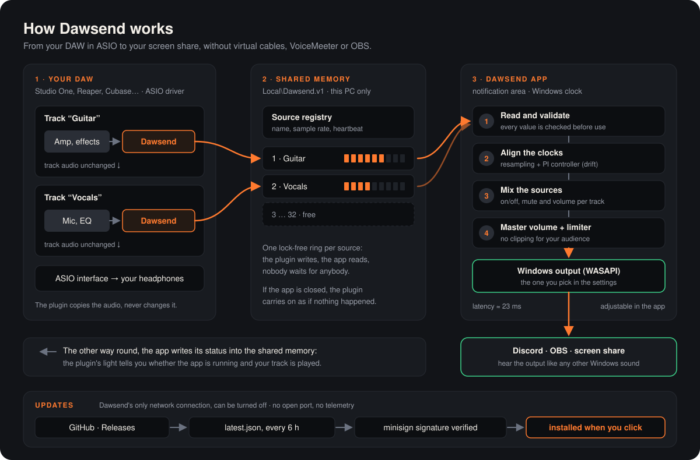

<div align="center">


<picture>
  <source media="(prefers-color-scheme: dark)" srcset="assets/wordmark.svg">
  
</picture>

**Your DAW's sound in your screen share. No hassle.**

[](https://github.com/Metaloul/Dawsend/releases/latest)
[](https://github.com/Metaloul/Dawsend/releases)
[](https://github.com/Metaloul/Dawsend/actions/workflows/ci.yml)
[](https://github.com/Metaloul/Dawsend/actions/workflows/security.yml)
[](https://scorecard.dev/viewer/?uri=github.com/Metaloul/Dawsend)
[](LICENSE)

[](#requirements)
[](#in-your-daw)
[](https://www.rust-lang.org)
[](https://v2.tauri.app)
[](https://svelte.dev)
[](https://github.com/robbert-vdh/nih-plug)

<a href="https://github.com/Metaloul/Dawsend/releases/latest"> <b>Download</b></a>
&nbsp;·&nbsp; <a href="#how-it-works">How it works</a>
&nbsp;·&nbsp; <a href="#troubleshooting">Troubleshooting</a>
&nbsp;·&nbsp; <a href="docs/SECURITE.md">Security</a>
&nbsp;·&nbsp; <a href="docs/EVOLUTIONS.md">Roadmap</a>

</div>

---

You play guitar (or anything else) in your DAW through an **ASIO** audio interface,
and you want your friends to hear it while you share your screen on Discord. The
problem: ASIO bypasses Windows audio, so Discord hears nothing.

**Dawsend** fixes that. One plugin on your track, a small app next to the clock, and
the track's sound also comes out of a regular Windows output that Discord, OBS or any
screen share can hear.

## Why Dawsend?

Because the existing options are a pain.

- **VoiceMeeter** is hell: buses, virtual cables, a default device to change in
  Windows, settings nobody understands, and crackles after a Windows update. You
  spend more time tweaking it than playing.
- **ReaStream + OBS** is less of a pain, since you only set it up once: ReaStream on
  the DAW track, a microphone source in OBS with ReaStream as a filter on it, and
  monitoring turned on so the system can hear it. But it means a whole streaming
  app running in the background, just to pass some audio along. Heavy, just for
  sound.

Dawsend does **one thing**, and needs no skills at all:

1. **Install it.**
2. **Pick your output** (or keep the Windows default).
3. **Put the plugin on your track.** Done.

No virtual cable, no driver, no default device to change, no OBS.

### What's in a name?

*DAW* + *send* describes the job. But mostly, it sounds like the first name
**Dawson**, and that made us laugh. That's it.

## Features

-  **Several tracks at
  once**: one plugin per track ("Guitar", "Vocals"…), each with its own on/off, mute
  and volume in the app. Settings follow the source name from one session to the
  next.
-  **No drift, no
  crackles**: your audio interface and Windows don't share the same clock. Dawsend
  resamples continuously (rubato, driven by a PI controller), so the sound never
  crackles and the delay never grows over the evening.
-  **Any sample rate**
  from 8 kHz to 768 kHz, on the DAW side as well as the Windows side, with
  anti-aliasing.
-  **Low, adjustable
  latency**: about 23 ms end to end by default, with a 3 to 50 ms safety margin.
-  **A discreet
  app** in the notification area, styled like a hardware front panel: one channel
  strip per source, segment meters, master volume, soft limiter.
-  **A plugin with a real
  interface**: link status light, source name, Send switch, stereo meter. The GitHub
  icon, in the plugin and in the app, opens the project page.
-  **Robust**: the
  app and the DAW start in any order. If the app is closed, the plugin simply passes
  audio through. Output unplugged? It is reopened automatically.
-  **Signed updates**,
  offered by the app, installed when you decide.
-  **English and
  French** (system language by default).
-  **Logs** for
  troubleshooting, with a detailed mode.

## How it works

<p align="center">
  
</p>

1. **The plugin** (VST3 or CLAP), inserted on a track, passes the audio through
   untouched and copies it into a local **shared memory**. It never waits for anyone:
   if the app is slow or closed, your DAW doesn't notice.
2. **The app** reads that memory, validates everything it finds there, aligns each
   source's clock with the Windows clock, mixes the tracks and plays the result on the
   output you chose (WASAPI).
3. **Discord, OBS or your screen share** hear that output like any other Windows
   sound.

Nothing goes over the network. The technical details (shared memory format, threads,
design decisions) are in [docs/ARCHITECTURE.md](docs/ARCHITECTURE.md) (in French).

## Requirements

- Windows 10 or 11, 64-bit.
- Microsoft Edge **WebView2** (built into Windows 11 and up-to-date Windows 10; the
  installer tells you otherwise).
- A DAW that loads **VST3** or **CLAP** plugins: Studio One, Cubase, Reaper, Bitwig,
  Ableton Live 12…

## Installation

Download **`Dawsend-Setup-<version>.exe`** from the
[latest release](https://github.com/Metaloul/Dawsend/releases/latest) and run it. It
installs:

- the **VST3** plugin in `C:\Program Files\Common Files\VST3`;
- the **CLAP** plugin in `C:\Program Files\Common Files\CLAP`;
- the app in `C:\Program Files\Dawsend`, with its Start menu shortcuts;
- optionally (checked by default): a desktop shortcut and start with Windows,
  minimized to the notification area.

Close your DAW before installing. The installer is not code-signed yet: if Windows
shows "Windows protected your PC", click **More info**, then **Run anyway**. To check
the file, compare its SHA-256 hash with the release's `SHA256SUMS.txt` (see
[Security](#security)).

Uninstall from **Settings › Apps** or from the Start menu.

### Portable version

Prefer not to install anything? Download **`Dawsend-<version>-portable.zip`** from the
same release and extract it anywhere (your user folder, a USB drive):

1. Close your DAW and copy the `Dawsend.vst3` folder to
   `C:\Program Files\Common Files\VST3` (or `Dawsend.clap` to
   `C:\Program Files\Common Files\CLAP`).
2. Run `dawsend.exe`.

The `portable.txt` file next to `dawsend.exe` turns on portable mode: settings and logs
are kept in a `data` folder next to it, and when a new version is out, the app opens the
download page instead of running the installer. To update, quit Dawsend and replace the
files with those from the new zip, keeping `data`. The portable version needs WebView2,
which ships with up-to-date Windows 10 and 11.

## Usage

### In your DAW

1. Insert **Dawsend** (category *Fx / Tools*) on your track, **last** in the chain if
   you want to send the processed sound.
2. Open the plugin: rename the source if you like, and check the status light.

| Light | Meaning |
|---|---|
|  "Linked — the app plays this track" | Everything works. |
|  "App running — track not played" | Enable the source in the app. |
|  "Linked — track muted in the app" | Unmute the source in the app. |
|  "Dawsend app closed" | Start the app: the link is made automatically. |
|  "Waiting for the audio engine" | Turn on your DAW's audio engine. |

When the **Send** switch is off, the plugin sends silence to the app. Your track's
sound itself is never changed.

> **Studio One**: if the plugin doesn't show up, go to *Options › Locations › VST
> Plug-ins*, click *Reset Blocklist*, then restart Studio One.

### The app

Click the Dawsend icon next to the clock to open the window. Closing it doesn't quit
Dawsend; to quit, right-click the icon, **Quit Dawsend**.

- **Sources**: one strip per plugin (on/off, mute, volume, meter, status, measured
  drift, dropouts). At the top: the output, the master volume and the button that
  mutes everything.
- **Settings**: audio output, safety margin (with the estimated total latency),
  language, start with Windows, updates, logs.
- **Tray icon menu** (right-click): open, mute, sources played, output, start with
  Windows, quit.

### With Discord

Share **your entire screen**, with sound. When you share a single window, Discord only
captures the sound of that window's application (your DAW, which outputs to ASIO),
not Dawsend's.

Also pick an output in Dawsend that **you aren't already monitoring through ASIO**,
otherwise you'll hear yourself twice with a slight echo.

## Updates

The app checks for a new version at startup, then every 6 hours, on the project's
[GitHub releases](https://github.com/Metaloul/Dawsend/releases). When one is
available, a banner shows up in the window (and a line in the tray menu) with the
release notes.

- **Nothing installs by itself**: you click **Install**.
- The installer is **signed**: the app rejects any file whose signature doesn't match
  Dawsend's key, or that claims a different version.
- **Close your DAW** first: Windows cannot replace a loaded plugin, and the app
  refuses to install while a track uses Dawsend.
- Your install choices (shortcut, VST3, CLAP) are kept, and the app restarts by
  itself at the end.
- To turn checking off: **Settings › Updates › Check for updates**.
- Portable version: the button reads **Download** and opens the release page; replace
  the files yourself (see [Portable version](#portable-version)).

What changed in each version: [CHANGELOG.md](CHANGELOG.md) (in French).

## Security

| | |
|---|---|
|  **No open port** | The plugin and the app talk through local shared memory. The only connection is the update check on `github.com`, which you can turn off. No telemetry, no account. |
|  **Signed updates** | [minisign](https://jedisct1.github.io/minisign/) signature checked before any install. |
|  **Code scanned on every change** | CodeQL, cargo-deny, cargo-audit, `pnpm audit`, OpenSSF Scorecard, Dependabot. |
|  **Antivirus** | Microsoft Defender on the binaries, VirusTotal on every published installer (link in the release notes). |
|  **SHA-256 hashes** | `SHA256SUMS.txt` published with every release. |

Detailed results, and how to run the checks yourself:
[docs/SECURITE.md](docs/SECURITE.md) (in French). To report a vulnerability
privately: [SECURITY.md](SECURITY.md).

## Troubleshooting

| Problem | Fix |
|---|---|
| Discord hears nothing | Share **your entire screen**, not a window. Check that the source is enabled (green light in the plugin). |
| No source in the app | The plugin must be on an **active** track, with the DAW's audio engine running. |
| The source is "Paused" | The DAW isn't running the plugin (track disabled, engine stopped). |
| Guitar heard twice, with a slight echo | The ASIO sound and the Windows output reach the same headphones. Pick an output you don't monitor. |
| Crackles, "dropouts" counter going up | Raise the safety margin in the settings. |
| "incompatible shared memory" | The plugin and the app aren't the same version: reinstall, then restart the DAW. |
| "Close your DAW first" when updating | Close the DAW (or remove Dawsend from your tracks), then click **Install** again. |
| The app window stays white | Install or repair Microsoft Edge WebView2. |

### Logs and settings

| What | Where |
|---|---|
| Settings | `%APPDATA%\com.metaloul.dawsend\settings.json` |
| Logs | `%LOCALAPPDATA%\com.metaloul.dawsend\logs\dawsend.log` (2 MB per file, 5 kept) |
| Start with Windows | `Dawsend` value of `HKCU\Software\Microsoft\Windows\CurrentVersion\Run` |
| Source name | saved with your DAW project |
| Portable version | settings and logs in the `data` folder next to `dawsend.exe` |

In the settings, the **Open folder** button (Logs section) opens the log folder; the
**Detailed log** switch adds the details, without restarting. To follow the log
live:

```powershell
Get-Content "$env:LOCALAPPDATA\com.metaloul.dawsend\logs\dawsend.log" -Wait -Tail 50
```

### Command-line tool

`dawsend-console.exe`, installed with the app, is for testing and diagnostics:

| Command | What it does |
|---|---|
| `dawsend-console list` | lists the sources published by the plugins |
| `dawsend-console devices` | lists the audio outputs |
| `dawsend-console sine --name Test` | publishes a test tone, as a plugin would |
| `dawsend-console sine --rate 192000 --ppm 300` | same, at another sample rate and with simulated drift |
| `dawsend-console play` | plays without a window (not at the same time as the app) |
| `dawsend-console play --source Guitar --device "Speakers" --latency 20` | plays one source on one output |

## Made with AI. So what?

Yes, Dawsend was written largely with AI (Claude, by Anthropic, in Claude Code). The
idea, the choices, the testing on a real audio interface with a real DAW, and the
sign-off on every step come from a human. A good chunk of the code and docs came from
the machine. We're not hiding it.

What matters is what comes out:

- the code is **public**, readable and commented;
- it passes **tests**, `clippy` with **zero warnings**, and **public** security scans
  on every change;
- the rules that matter for audio (nothing that blocks the DAW, no allocation on the
  real-time thread) are written down and checked.

And to those who trash it on principle: you use it too, from your editor's
autocomplete to your everyday searches. Pretending otherwise doesn't make your code
any better. If you find a bug, a vulnerability or ugly code, **open an issue**: that's
the only kind of criticism that moves the project forward.

## Roadmap

The ideas under consideration (first-run wizard, VBAN to another PC, OBS plugin,
Linux and macOS, Discord audio back into the DAW…) are detailed and ranked in
[docs/EVOLUTIONS.md](docs/EVOLUTIONS.md) (in French). The guiding rule: every
addition stays invisible to people who don't need it.

## Development

### Requirements

1. **Visual Studio Build Tools**, "Desktop development with C++" workload.
2. **Rust** 1.93 or newer (<https://rustup.rs>).
3. **Git**: Cargo needs it to fetch nih-plug, pinned to a commit.
4. **Node.js** 22 and **pnpm** 10, for the app's interface (`ui/`).
5. **NSIS 3** (<https://nsis.sourceforge.io>), for the installer.

### Layout

| Folder | Contents |
|---|---|
| `crates/dawsend-core` | shared memory format (binary contract), lock-free ring, source registry |
| `crates/dawsend-plugin` | nih-plug plugin (VST3 + CLAP), egui interface |
| `crates/dawsend-app` | audio engine (resampling, drift, mixing, WASAPI output) and `dawsend-console` |
| `crates/dawsend-gui` | Tauri 2 app (`dawsend.exe`): window, tray, settings, updates, logs |
| `ui/` | the app's Svelte 5 interface |
| `installer/` | NSIS installer |
| `scripts/` | release tooling (`latest.json`), README icons |
| `assets/` | logo, icons, fonts, palette |
| `docs/` | specification, architecture, security, roadmap, test procedures (in French) |

### Commands

```powershell
cargo test --workspace                        # tests
cargo clippy --workspace --all-targets        # must stay warning-free
cargo fmt --all
cargo deny check                              # vulnerabilities, licenses, sources
cargo xtask bundle dawsend-plugin --release   # → target\bundled\Dawsend.vst3 and Dawsend.clap
pnpm --dir ui install; pnpm --dir ui build    # interface → ui\dist
cargo build --release -p dawsend-gui          # → target\release\dawsend.exe
powershell -ExecutionPolicy Bypass -File installer\build.ps1   # full installer
```

The installer lands in `target\installer\Dawsend-Setup-<version>.exe`.
`installer/build.sh` builds the same one from Linux (mingw-w64, NSIS, Node.js, pnpm).

Interface with hot reload: `pnpm --dir ui dev` in one terminal, then
`cargo run -p dawsend-gui --no-default-features` in another.

Testing without a DAW: `dawsend-console sine --name Guitar`, then the app.

### Releasing

1. Bump the version in `Cargo.toml` (`[workspace.package]`).
2. Add its `## X.Y.Z` section at the top of [CHANGELOG.md](CHANGELOG.md), written for
   users: it becomes the release notes and the text of the update banner.
3. Push the `vX.Y.Z` tag. The [Release](.github/workflows/release.yml) workflow tests,
   builds the installer and the portable zip, signs the installer, writes `latest.json`
   and `SHA256SUMS.txt`, publishes the release and has it scanned by VirusTotal.

Repository secrets: `TAURI_SIGNING_PRIVATE_KEY` and `TAURI_SIGNING_PRIVATE_KEY_PASSWORD`
(private signing key and its password), optionally `VT_API_KEY`.

### Project rules

- Plugin audio thread and output callback: **no allocation, no lock, no blocking
  call**.
- The plugin never blocks the DAW; at the slightest problem, it passes audio through.
- The shared memory format is a versioned binary contract.
- The app validates everything it reads from shared memory.

Details: [docs/ARCHITECTURE.md](docs/ARCHITECTURE.md). Working with a coding agent
(Claude Code, Codex, Cursor, Copilot…)? Everything it needs to know is in
[AGENTS.md](AGENTS.md).

## Contributing

Issues and pull requests are welcome. Before a PR: `cargo fmt`, `cargo clippy` with
no warnings, `cargo test` and `cargo deny check` must pass (CI checks them). For a
security issue, use [private reporting](SECURITY.md), not an issue.

## License

- Dawsend's code is released under the **MIT** license: see [LICENSE](LICENSE).
  Copyright Romain Rousseau (Metaloul).
- The **VST3** binary includes the `vst3-sys` bindings, licensed under GPLv3, so it is
  distributed under the terms of the **GPLv3**
  ([LICENSES/GPL-3.0.txt](LICENSES/GPL-3.0.txt)). The **CLAP** binary and the app are
  not subject to this.
- The interface fonts (Familjen Grotesk, Geist Mono) are under the **SIL Open Font
  License 1.1**: see [LICENSES/OFL-1.1.txt](LICENSES/OFL-1.1.txt).
- README icons: [Primer Octicons](https://github.com/primer/octicons), MIT
  ([docs/icons/LICENSE-octicons.txt](docs/icons/LICENSE-octicons.txt)).
- VST is a trademark of Steinberg Media Technologies GmbH. Discord, OBS, GitHub and the
  other names mentioned belong to their owners; Dawsend is not affiliated with any of
  them.
