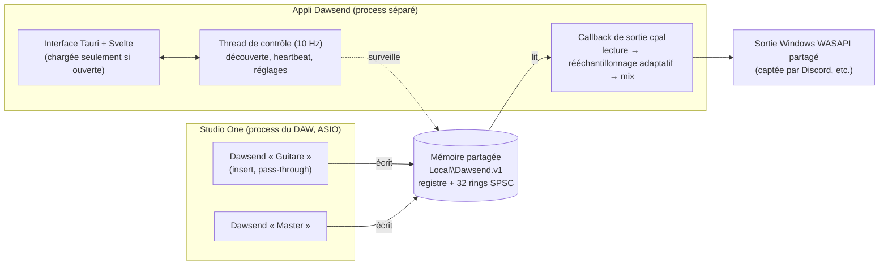

# Dawsend — Architecture (proposition v1)

> Statut : **proposition, en attente de validation**. Aucun code n'est écrit tant que
> les points de la section 9 « Décisions à valider » ne sont pas tranchés.

## 1. Vue d'ensemble



Principes directeurs :

- **Le plugin ne dépend jamais de l'appli.** Il écrit dans un ring « avec perte » :
  il n'attend jamais le lecteur et ne lit même pas sa position. Si l'appli est
  absente ou lente, les anciennes données sont simplement écrasées.
- **Tout passe par une seule mémoire partagée de taille fixe.** Il n'y a ni socket,
  ni pipe, ni événement noyau. Les deux côtés n'utilisent que des opérations
  atomiques. Le nom contient la version du format (`v1`) : deux versions
  incompatibles ne se partagent donc jamais la même zone.
- **Une mémoire entièrement à zéro est un état valide** (« aucune source »). Le plugin
  et l'appli peuvent ainsi la créer dans n'importe quel ordre.
- **L'appli ne fait jamais confiance au contenu de la mémoire partagée.** Elle
  valide chaque champ (bornes, cohérence) et ne doit ni paniquer ni avoir de
  comportement indéfini, même face à des données corrompues.

## 2. Workspace Cargo

```
Dawsend/
├─ Cargo.toml                  # workspace
├─ LICENSE                     # MIT, Copyright Romain Rousseau (Metaloul)
├─ README.md
├─ docs/                       # cahier des charges, architecture, notes de test
├─ xtask/                      # « cargo xtask bundle » (nih-plug) + tâches de paquetage
├─ crates/
│  ├─ dawsend-core/            # sans dépendance audio ni GUI
│  │  └─ src/
│  │     ├─ layout.rs          # structures #[repr(C)], constantes, asserts de taille/offset
│  │     ├─ ring.rs            # Producer / Consumer SPSC sur pointeurs bruts
│  │     ├─ registry.rs        # réservation et libération de slots, seqlock des métadonnées
│  │     ├─ shm/               # IPC isolée par plateforme
│  │     │  ├─ mod.rs          #   trait SharedRegion { open_or_create, as_ptr, len }
│  │     │  ├─ windows.rs      #   CreateFileMappingW / MapViewOfFile (windows-sys)
│  │     │  └─ unix.rs         #   shm_open / mmap (Linux et macOS)
│  │     ├─ clock.rs           # horloge monotone en ns, commune aux processus (QPC / CLOCK_MONOTONIC)
│  │     └─ process.rs         # « ce PID est-il vivant ? » (+ heure de création, contre la réutilisation de PID)
│  ├─ dawsend-plugin/          # nih-plug, export VST3 + CLAP, GUI nih_plug_egui
│  └─ dawsend-app/
│     ├─ src/
│     │  ├─ engine/            # indépendant de la plateforme
│     │  │  ├─ discovery.rs    #   suivi des slots, heartbeat, sources mortes
│     │  │  ├─ source.rs       #   lecteur d'une source + rééchantillonneur + régulateur de dérive
│     │  │  ├─ drift.rs        #   régulateur PI sur le remplissage
│     │  │  └─ mixer.rs        #   gains lissés, mute, vumètres
│     │  ├─ output/            # backend audio isolé par plateforme
│     │  │  ├─ mod.rs          #   trait AudioOutput
│     │  │  ├─ cpal.rs         #   Windows (WASAPI partagé) et macOS (CoreAudio)
│     │  │  └─ pipewire.rs     #   Linux : nœud PipeWire nommé « Dawsend »
│     │  ├─ settings.rs        # JSON dans %APPDATA%\Dawsend (et équivalents)
│     │  └─ bin/dawsend-console.rs   # appli console de l'étape 1
│     └─ ui/                   # Svelte (étape 4) ; dawsend-app devient la crate Tauri
```

`dawsend-app` contient une **bibliothèque** (le moteur) et plusieurs binaires : la
console des étapes 1 à 3, puis l'appli Tauri à partir de l'étape 4. Le moteur
ne connaît pas Tauri, ce qui permet de le tester sous Linux en CI sans interface.

## 3. Format de la mémoire partagée (v1)

### 3.1 Nom et création

| Plateforme | Objet | Nom |
|---|---|---|
| Windows | file mapping adossé au fichier d'échange | `Local\Dawsend.v1` |
| Linux | `shm_open` | `/dawsend.v1.<uid>` |
| macOS | `shm_open` (31 caractères max) | `/dawsend.v1.<uid>` |

- `Local\` correspond à la session Windows de l'utilisateur. Le DAW et l'appli y
  sont tous les deux, et ce préfixe ne demande aucun privilège (contrairement à
  `Global\`).
- Les deux côtés font un *open-or-create*. Sous Windows, `CreateFileMappingW` ouvre
  la zone si elle existe déjà. Elle est détruite quand le dernier processus la
  ferme : il n'y a rien à nettoyer.
- Sous Unix, l'objet persiste après la fermeture. Le format le supporte sans
  problème, car les slots orphelins sont repérés par leur PID (§ 3.5).
- **Taille totale : 8 400 896 octets (~8 Mio).** La mémoire n'est réellement
  allouée qu'au premier accès, donc au premier slot utilisé.

### 3.2 Plan mémoire

Tous les entiers sont en *little-endian* natif (x86-64 et ARM64). Les champs
`Atomic*` sont accédés uniquement par des opérations atomiques. La taille et
les offsets de chaque structure sont vérifiés à la compilation
(`const _: () = assert!(…)`).

```
offset 0        En-tête global ............................... 256 o
offset 256      Table des slots : 32 × 256 o ................. 8 192 o
offset 8 448    (bourrage jusqu'à l'alignement sur une page)
offset 12 288   Données : 32 rings × 32 768 trames × 2 canaux × 4 o = 32 × 256 Kio
```

#### En-tête global (256 octets)

| Off. | Type | Champ | Description |
|---:|---|---|---|
| 0 | `[u8; 8]` | `magic` | `b"DAWSEND\0"` |
| 8 | `u32` | `layout_version` | `1` |
| 12 | `AtomicU32` | `init_state` | 0 = vierge, 1 = initialisation en cours, 2 = prête |
| 16 | `u32` | `header_size` | 256 |
| 20 | `u32` | `slot_count` | 32 |
| 24 | `u32` | `slot_header_size` | 256 |
| 28 | `u32` | `max_channels` | 2 |
| 32 | `u32` | `ring_capacity_frames` | 32 768 (puissance de 2) |
| 36 | `u32` | — | réservé |
| 40 | `u64` | `data_offset` | 12 288 |
| 48 | `u64` | `total_size` | 8 400 896 |
| 56–63 | | — | réservé |
| **64** | `AtomicU32` | `app_pid` | PID de l'appli, 0 si absente *(ligne de cache de l'appli)* |
| 68 | `AtomicU32` | `app_flags` | bit 0 : lecture active |
| 72 | `AtomicU64` | `app_start_time` | heure de création du processus de l'appli |
| 80 | `AtomicU64` | `app_heartbeat_ns` | horloge monotone, mise à jour toutes les 100 ms |
| 88–255 | | — | réservé (zéro) |

**Initialisation.** Le premier ouvrant fait un CAS de `init_state` de 0 à 1, écrit
les constantes, puis passe `init_state` à 2 (*Release*). Les autres attendent
au plus 100 ms que l'état passe à 2. Cette attente a lieu dans `initialize()`
pour le plugin, jamais sur le thread audio. Si `magic` ou `layout_version` ne
correspondent pas, le côté concerné refuse la zone : le plugin reste en simple
pass-through et affiche « version incompatible ».

#### En-tête d'un slot (256 octets = 4 lignes de cache)

Chaque ligne de cache n'a qu'un seul écrivain, pour éviter le *false sharing*
entre le thread audio du DAW et l'appli.

| Off. | Type | Champ | Écrivain | Description |
|---:|---|---|---|---|
| **0** | `AtomicU32` | `seq` | plugin (hors RT) | seqlock des métadonnées : impair = modification en cours |
| 4 | `AtomicU32` | `state` | plugin / appli | 0 = libre, 1 = réservation en cours, 2 = active |
| 8 | `u32` | `owner_pid` | plugin | PID du DAW |
| 12 | `u32` | `sample_rate` | plugin | Hz, par exemple 48 000 |
| 16 | `u64` | `owner_start_time` | plugin | heure de création du process du DAW |
| 24 | `u64` | `instance_id` | plugin | aléatoire, stable pendant la vie de l'instance |
| 32 | `u32` | `channels` | plugin | 1 ou 2 |
| 36 | `u32` | `flags` | plugin | bit 0 : envoi activé |
| 40 | `u32` | `generation` | plugin | +1 à chaque réservation : l'appli détecte qu'un slot a été réutilisé |
| 44–63 | | — | | réservé |
| **64** | `[u8; 64]` | `name` | plugin (hors RT) | nom UTF-8 complété par des NUL, protégé par `seq` |
| **128** | `AtomicU64` | `write_pos` | **thread audio** | trames écrites depuis la réservation (monotone, ne reboucle jamais) |
| 136 | `AtomicU64` | `producer_heartbeat_ns` | **thread audio** | horloge monotone, à chaque bloc traité |
| 144–191 | | — | | réservé |
| **192** | `AtomicU64` | `read_pos` | appli | position de lecture (informative, pour l'affichage) |
| 200 | `AtomicU64` | `consumer_heartbeat_ns` | appli | l'appli lit cette source (affiché par le plugin) |
| 208 | `AtomicU32` | `consumer_flags` | appli | bit 0 : en écoute, bit 1 : muette dans l'appli |
| 212–255 | | — | | réservé |

#### Données d'un ring

```
ring[slot] = data_offset + slot × (ring_capacity_frames × max_channels × 4)
échantillon(pos, ch) = ring[slot][(pos mod capacité) × max_channels + ch]
```

Les échantillons sont des `f32` entrelacés, stockés sous forme de bits dans des
`AtomicU32` (accès *Relaxed*). Cela compile en simples `mov` sur x86-64 et ARM64,
et reste formellement correct dans le modèle mémoire de Rust malgré la lecture
concurrente. Pour une source mono, seul le canal 0 est écrit, et l'appli le
duplique sur la sortie stéréo.

**Capacité : 32 768 trames**, soit 680 ms à 48 kHz et 170 ms à 192 kHz. C'est
largement au-dessus de la latence visée (20 à 30 ms), et ça encaisse un DAW
réglé avec un très gros buffer ASIO (2 048 échantillons).

### 3.3 Protocole d'écriture (thread audio du plugin)

```text
pour chaque bloc de n trames :
    w = write_pos.load(Relaxed)            // seul écrivain : pas besoin d'Acquire
    copier les n trames en ring[(w + i) mod C]   (stores Relaxed)
    write_pos.store(w + n, Release)        // publie les données
    producer_heartbeat_ns.store(now, Relaxed)
```

- Pas de branche sur la présence de l'appli ni lecture de `read_pos` : le coût
  est constant et prévisible (une copie mémoire du bloc).
- `now` vient de `QueryPerformanceCounter` (ou de `clock_gettime`), qui ne bloque
  pas. La fréquence du compteur est lue une seule fois dans `initialize()`.
- Si le bloc dépasse la capacité (impossible en pratique), seules les C
  dernières trames sont copiées.

### 3.4 Protocole de lecture (appli) : ring avec perte et validation

```text
w1 = write_pos.load(Acquire)
dispo = w1 − r
si dispo > C − marge : dépassement → resynchroniser (r = w1 − cible), fondu
copier m trames depuis r
w2 = write_pos.load(Acquire)
si w2 − r > C : l'écrivain a pu écraser la zone copiée → trames jetées, resynchroniser
r += m
```

C'est le principe du seqlock, appliqué au ring. Comme le lecteur n'impose
jamais d'attente à l'écrivain, le plugin reste totalement indépendant.

### 3.5 Cycle de vie d'un slot

| Événement | Où | Action |
|---|---|---|
| `initialize()` du plugin | hors RT | ouvre la zone et cherche un slot libre (CAS de `state` 0→1). Puis `seq` impair, écriture des métadonnées, `write_pos = 0`, `generation += 1`, `seq` pair, `state = 2` (*Release*). |
| Changement de fréquence ou de canaux | hors RT (`initialize()` rappelée) | même séquence sur le même slot, avec `generation += 1` : l'appli recrée son lecteur. |
| Renommage depuis l'interface du plugin | thread de l'interface | `seq` impair, écriture de `name`, `seq` pair. Un `Mutex` local au process sérialise interface et `initialize()` (jamais sur le thread audio). |
| Destruction de l'instance | hors RT (`Drop`) | `state = 0`. |
| Crash du DAW | — | l'appli voit que `owner_pid` est mort (PID et heure de création comparés) et libère le slot par CAS 2→0. Un plugin qui cherche un slot libre peut faire la même chose. |
| Lecture des métadonnées par l'appli | thread de contrôle | lit `seq`, copie, relit `seq` ; recommence si `seq` est impair ou a changé. |

### 3.6 Heartbeat et états d'une source dans l'appli

| État | Condition | Comportement |
|---|---|---|
| **Active** | `producer_heartbeat_ns` date de moins de 250 ms | lecture normale |
| **En pause** | heartbeat plus vieux que 250 ms, processus vivant (DAW arrêté ou transport suspendu) | silence (fondu de sortie), la lecture se réamorce dès que le flux reprend |
| **Morte** | PID mort | slot libéré, source retirée de la liste |

Dans l'autre sens, le plugin affiche :

- « Appli connectée » si `app_heartbeat_ns` date de moins d'1 s ;
- « En écoute » si `consumer_heartbeat_ns` du slot est récent ;
- « Appli absente » sinon.

## 4. Plugin (`dawsend-plugin`)

- **nih-plug**, export **VST3 et CLAP**. Configurations d'entrées/sorties : stéréo
  → stéréo et mono → mono. Le traitement se fait en place : le son n'est pas
  touché, le pass-through est donc parfait.
- **Paramètres** : `Envoi` (booléen, automatisable). Le **nom de la source** est un
  état persistant (`#[persist]`), sauvegardé avec le projet Studio One. Il vaut
  « Dawsend 1 », « Dawsend 2 »… par défaut.
- **Thread audio** : copie dans le ring, calcul de crête par canal vers des
  `AtomicF32` locaux (pour le vumètre), heartbeat. Aucune allocation, aucun
  verrou, aucun appel système bloquant. Vérification en CI avec
  `assert_no_alloc` (fonctionnalité fournie par nih-plug) dans les builds de
  debug.
- **`initialize()` / `Drop`** : seuls endroits qui ouvrent la zone et réservent ou
  libèrent un slot. La zone est partagée par toutes les instances d'un même
  process (`OnceLock<Arc<Region>>`). Si l'ouverture échoue, le plugin passe en
  mode dégradé : simple pass-through, avec le message affiché dans
  l'interface. Il ne plante jamais et ne bloque jamais le DAW.
- **Interface** (`nih_plug_egui`, environ 300 × 160 px) : champ de nom, pastille
  d'état (connectée, en écoute, absente, incompatible), vumètre stéréo, bouton
  Envoi.

## 5. Appli (`dawsend-app`)

### 5.1 Threads

| Thread | Rôle | Fréquence |
|---|---|---|
| **Callback de sortie** (créé par cpal / WASAPI, priorité haute) | pour chaque source : lecture du ring, rééchantillonnage, gain, mix, limitation douce et vumètres. Aucune allocation, aucun verrou. | à chaque période WASAPI (environ 10 ms) |
| **Contrôle** | découverte des slots, heartbeat de l'appli, détection des sources mortes, création des lecteurs (allocation ici), envoi au callback par une file lock-free (`rtrb`), sauvegarde des réglages | 10 Hz |
| **Interface** Tauri | fenêtre et icône de la barre des tâches. Vumètres envoyés à 30 Hz, **uniquement quand la fenêtre est visible** | à la demande |

Pour garder le CPU quasi nul au repos : le flux de sortie est mis en pause quand
aucune source n'est active depuis 5 s. Il ne reste alors que le thread de
contrôle, qui se réveille 10 fois par seconde pour quelques lectures atomiques.

### 5.2 Dérive d'horloge et fréquences différentes

Chaque source a son propre rééchantillonneur asynchrone **rubato** (sinc, taille
fixe en sortie, buffers préalloués, `process_into_buffer` sans allocation).

- **Rapport nominal** = `fs_sortie / fs_source`. Cela couvre les fréquences
  différentes, par exemple 44,1 kHz → 48 kHz.
- **Correction de dérive** : à chaque callback, on mesure le remplissage
  `F = write_pos − read_pos` (en trames source).
  - `F` forme une dent de scie de l'amplitude d'un bloc ASIO : on le lisse
    (moyenne exponentielle sur environ 1 s).
  - Un régulateur **PI** compare ce remplissage lissé à la cible `T` et ajuste le
    rapport : `ratio = nominal × (1 + Kp·e + Ki·∫e)`.
  - La correction est bornée à ±1 000 ppm et appliquée en rampe
    (`set_resample_ratio_relative(…, ramp = true)`). Les écarts réels entre
    horloges sont de l'ordre de ±50 à 200 ppm : la variation de hauteur est
    donc inaudible.
- **Amorçage** : on attend que `F ≥ T`, puis la lecture démarre avec un fondu
  d'entrée de 5 ms.
- **Sous-alimentation** (`F` < besoin du callback) : fondu de sortie vers le
  silence, retour en amorçage, compteur d'underruns incrémenté. On n'entend
  qu'un trou, jamais un craquement.
- **Dépassement** (`F` > `T` + 3 blocs, ou données écrasées) : saut de `read_pos`
  à `write_pos − T`, avec un fondu croisé court.

### 5.3 Budget de latence (48 kHz, buffer ASIO de 128)

| Étape | Latence |
|---|---:|
| Bloc ASIO (le plugin écrit en fin de bloc) | 2,7 ms |
| Cible du ring (réglable de 5 à 50 ms, **10 ms par défaut**) | 10 ms |
| Délai du rééchantillonneur sinc | ~1 ms |
| WASAPI partagé (période + moteur Windows) | ~10 à 13 ms |
| **Total** | **~24 à 27 ms** |

Ce qui est « réglable » dans l'interface, c'est la cible `T`. L'appli affiche
aussi la latence totale estimée.

### 5.4 Mixage

- Gain par source (lissé sur 20 ms), mute, gain master, puis limiteur doux
  pour éviter la saturation numérique quand plusieurs sources s'additionnent.
- Les réglages sont **associés au nom de la source**, car l'`instance_id` change
  à chaque session.
- Avertissement dans la doc : ne pas envoyer à la fois « Guitare » et
  « Master », sinon la guitare est entendue deux fois.

### 5.5 Réglages et intégration système

- Fichier `settings.json` dans `%APPDATA%\Dawsend\` (`~/.config/dawsend/` sous
  Linux, `~/Library/Application Support/Dawsend/` sous macOS).
- Une seule instance de l'appli à la fois (`tauri-plugin-single-instance`).
- Démarrage avec Windows : `tauri-plugin-autostart`, qui utilise la clé
  `HKCU\…\Run`, sans droits administrateur.
- Périphérique de sortie mémorisé par nom, avec retour à la sortie par défaut
  si ce périphérique a disparu.
- Changement de périphérique ou débranchement : le stream est recréé par le
  thread de contrôle.

## 6. Isolation par plateforme

| Préoccupation | Abstraction | Windows | Linux | macOS |
|---|---|---|---|---|
| Mémoire partagée | `core::shm::SharedRegion` | `windows-sys` : `CreateFileMappingW` | `rustix` : `shm_open` + `mmap` | idem Linux |
| Horloge commune aux processus | `core::clock` | `QueryPerformanceCounter` | `CLOCK_MONOTONIC` | `mach_absolute_time` |
| PID vivant | `core::process` | `OpenProcess` + `GetProcessTimes` | `/proc/<pid>/stat` | `proc_pidinfo` |
| Sortie audio | `app::output::AudioOutput` | cpal (WASAPI partagé) | **PipeWire natif** : nœud « Dawsend » visible dans le partage d'écran et pavucontrol | cpal (CoreAudio) |
| Démarrage auto | plugin Tauri | registre `Run` | `~/.config/autostart` | LaunchAgent |

Le moteur (`engine/`) et le format (`layout.rs`, `ring.rs`) n'ont aucun `#[cfg]`
de plateforme. Ils sont donc testés sous Linux en CI dès l'étape 1, avec un
test « deux processus » qui fait tourner un vrai producteur et un vrai
consommateur sur la mémoire partagée.

## 7. Licences

| Composant | Licence | Conséquence |
|---|---|---|
| Code Dawsend | MIT | — |
| nih-plug | ISC | compatible MIT |
| **`vst3-sys`** (bindings VST3 utilisés par nih-plug) | **GPLv3** | ⚠️ voir ci-dessous |
| SDK VST3 de Steinberg | **MIT** (relicencié par Steinberg, vérifié dans leur dépôt) | plus de contrat Steinberg à signer. Le **logo et la marque « VST »** suivent leurs propres règles d'usage. |
| `clap-sys` / CLAP | MIT / Apache-2.0 | aucune contrainte |
| cpal | Apache-2.0 | aucune contrainte |
| rubato, rtrb | MIT | aucune contrainte |
| Tauri 2, windows-sys, rustix, egui | MIT / Apache-2.0 | aucune contrainte |
| Svelte | MIT | aucune contrainte |

**La contrainte importante.** nih-plug déclare lui-même que les plugins VST3
construits avec lui doivent respecter la GPLv3, à cause de `vst3-sys`. Ton
**code source** reste sous MIT : la MIT est compatible avec la GPL et le code
peut être réutilisé sous MIT. Mais **le binaire `.vst3` distribué** est une œuvre
combinée, qui doit être distribuée selon la GPLv3. Concrètement :

- pour un projet open source sur GitHub, ça ne change rien de pratique : les
  sources sont publiques, et on mentionne la GPLv3 pour le binaire VST3 ;
- en revanche, ça interdit une distribution fermée ou commerciale propriétaire
  du `.vst3` ;
- le binaire **CLAP n'a pas cette contrainte** : il est MIT de bout en bout ;
- à terme, la crate `vst3` (coupler-rs, MIT/Apache-2.0, générée depuis le SDK
  désormais MIT) pourrait remplacer `vst3-sys`. Cela demanderait de patcher
  nih-plug : pas pour maintenant.

Une vérification `cargo deny check licenses` en CI signalera toute dépendance
qui ajouterait une contrainte.

Autre point : nih-plug n'est pas publié sur crates.io. On le référence par Git,
**épinglé sur un commit précis** pour que les builds soient reproductibles.

## 8. Étapes et tests

| Étape | Livrable | Ce que tu testes |
|---|---|---|
| **1. Prototype** | `dawsend-core` complet (format et ring), plugin sans interface (nom par défaut), `dawsend-console --list` et `dawsend-console --play <nom>` (rapport fixe, sans correction de dérive) | Plugin en insert sur la guitare dans Studio One, console lancée : le son sort sur les haut-parleurs Windows, et Discord le capte. Lancer l'appli avant ou après le DAW, fermer le DAW en pleine lecture : rien ne doit planter. |
| **2. Dérive et latence** | rubato, régulateur PI, fondus, option `--latency 15`, statistiques dans la console (remplissage, ppm, underruns) | Laisser tourner 30 min : pas de dérive du décalage, pas de craquement. Tester avec le projet à 44,1 kHz et Windows à 48 kHz. |
| **3. Multi-sources** | mixage, gains, mute, interface du plugin (nom, état, vumètre) | Deux instances (« Guitare » et « Voix »), réglage des volumes depuis la console. |
| **4. Interface** | Tauri + Svelte, icône de barre des tâches, réglages sauvegardés, démarrage auto | Utilisation au quotidien. |
| **5. Empaquetage** | installeur (NSIS via Tauri) qui installe l'appli et copie `Dawsend.vst3` / `Dawsend.clap` dans `C:\Program Files\Common Files\VST3` et `…\CLAP` | Installation et désinstallation sur une machine propre. |
| **6. Linux puis macOS** | backend PipeWire, puis CoreAudio, mémoire partagée Unix | — |

**Comment tu récupères les builds Windows.** Je travaille dans un conteneur
Linux : j'y compile et teste le cœur et le moteur, mais pas le son WASAPI ni
Studio One. Je propose une **CI GitHub Actions** (`windows-latest`) qui produit à
chaque push un zip téléchargeable : `Dawsend.vst3`, `Dawsend.clap` et
`dawsend-console.exe`. Tu n'as alors pas besoin d'installer Rust. (Tu peux aussi
compiler toi-même : `cargo xtask bundle dawsend-plugin --release`.)

## 9. Décisions à valider avant de coder

1. **Licence du binaire VST3** : on accepte que le `.vst3` soit distribué sous
   GPLv3 (le code restant MIT) ? Ou on livre **CLAP uniquement** ? Studio One
   charge les CLAP dans ses versions récentes : à vérifier dans la tienne.
   *Ma recommandation : VST3 + CLAP, avec la mention GPLv3 pour le VST3.*
2. **2 canaux maximum par source** (mono ou stéréo). Un master surround serait
   réduit en stéréo. *Recommandé.*
3. **32 sources simultanées maximum, ring de 32 768 trames** (~8 Mio de mémoire
   partagée). *Recommandé.*
4. **Builds Windows via GitHub Actions** sur le dépôt `metaloul/dawsend` : OK ?
5. **Interface du plugin en egui** (léger, sans dépendance web). *Recommandé.*
6. **Latence cible par défaut : 10 ms dans le ring** (~25 ms au total).
